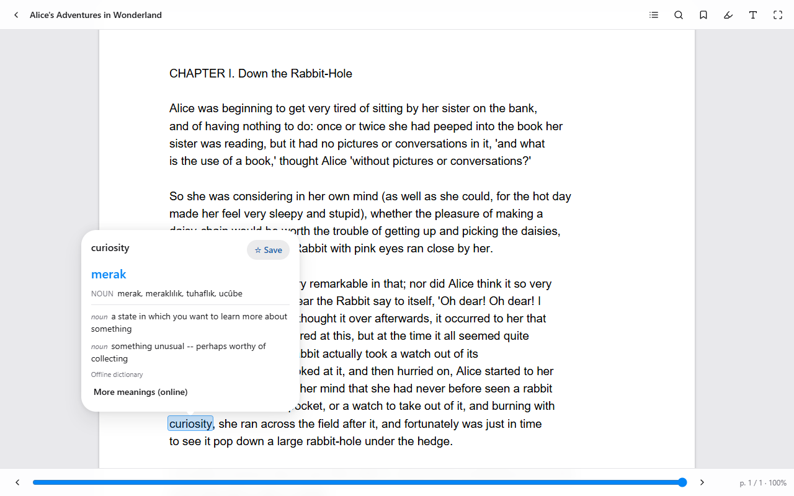
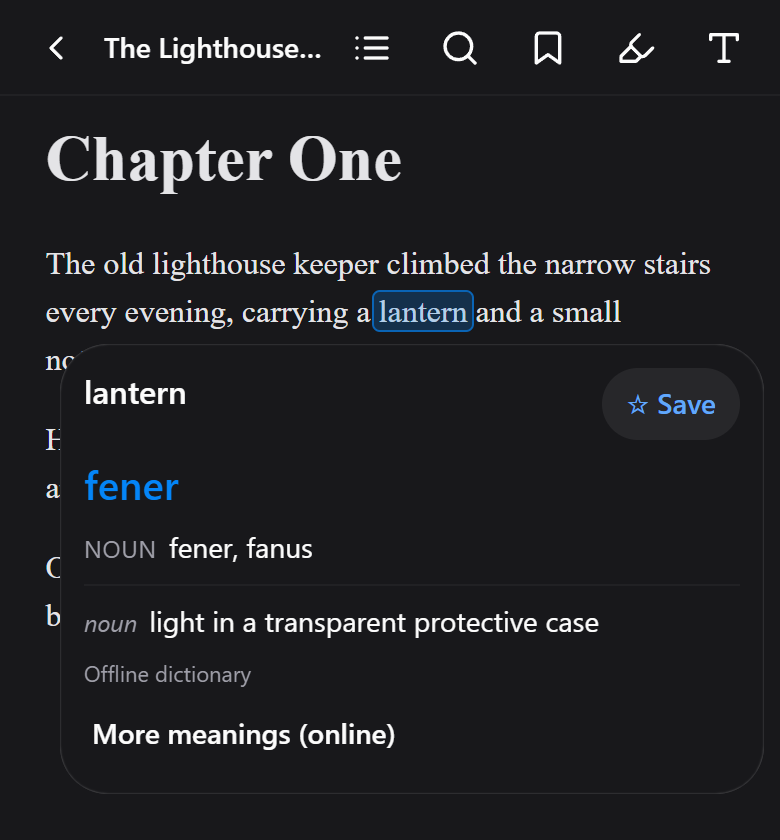
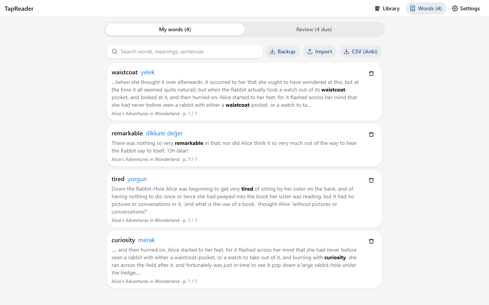

# TapReader

Read PDFs, e-books, documents, web articles and comics. **Tap any English word** and a small popup shows its
Turkish meaning (other target languages work online), an English definition with an example, and a ☆ Save button
for your word list.

Installable web app (PWA) for phone, tablet and PC. Works offline. Your files and words stay on your device.

<p>
  
</p>
<p>
  
  
</p>

## Features

- **Formats:** PDF (incl. scanned), EPUB, MOBI, AZW3, FB2, DOCX, ODT, RTF, TXT, Markdown, HTML, CBZ/CBR/CB7 comics,
  images, web articles (paste a link).
- **Translation:** built-in EN→TR dictionary (≈40,000 words, works offline; base forms like *went → go*), online
  fallback (Google Translate / MyMemory) and a "More meanings" button. Select several words → translate the phrase.
- **OCR:** scanned PDF pages, photos and comic speech bubbles are read on first tap (Tesseract.js, on-device).
- **Reader:** library with covers and progress, resume position, contents, search, bookmarks, highlights with notes,
  light / sepia / dark, text size, line spacing, margins, font, pages or continuous scroll, zoom, full screen,
  keyboard and swipe page turns. Saved words are underlined when they appear again.
- **Word list:** search, flashcards (spaced repetition), backup / import (JSON), export for Anki (CSV).

## How to use

1. **Open something to read.** In **Library**, press **Open a file** / **Add file**, or drop a file anywhere on the
   page. For a web page, press **Web article** and paste the link. Not sure yet? Press **Try a sample**.
2. **Tap a word you don't know.** A popup shows the Turkish meaning, an English definition and an example.
   Press **More meanings (online)** for more translations.
3. **Save it.** Press **☆ Save** in the popup. The word goes to your word list together with its sentence, and it is
   underlined whenever it shows up again.
4. **Translate a phrase.** Select several words, then press **Translate** in the bar at the bottom. The same bar has
   **Highlight** and **Copy**.
5. **Review.** Open **Words** → **Review** → **Start review**. Read the word, press **Show meaning**, then
   **I knew it** or **Again**. Words you miss come back sooner.

Reader top bar, left to right: back to library, contents, search, bookmark, highlights and bookmarks, display
settings (theme, text size, line spacing, margins, font, page turning), full screen. Turn pages with the arrows at the
bottom, the arrow / Page Up / Page Down keys, or by swiping.

**Keep your words safe:** everything is stored only in this browser. Use **Words → Backup** now and then, and
**Import** that file on another device. **CSV (Anki)** exports the list for Anki.

**Install as an app:** open the deployed site in Chrome / Edge / Safari and choose *Install app* or
*Add to Home Screen*. After the first visit it works offline. Change the translation language in
**Settings → Translate words into** (languages other than Turkish need internet).

## Run locally

```bash
npm install
npm run dev
```

Open http://localhost:5173. To try it on a tablet/phone on the same Wi-Fi: `npm run dev -- --host`
(installing as an app needs HTTPS, i.e. the deployed version).

## Tests

```bash
npm test                 # unit tests (Vitest)
npm run test-files       # generate sample files for every format into test-files/
npm run e2e              # end-to-end in headless Microsoft Edge (dev server must be running)
node scripts/e2e-offline.mjs http://localhost:4173   # offline test against `npx vite preview`
```

## Dictionary

`public/dict/` is generated and committed. To rebuild it:

```bash
npm run dict:data   # downloads WikDict en-tr, WordNet 3.1, a word-frequency list into data/
npm run dict        # writes public/dict/ (sharded JSON)
```

## Deploy (Cloudflare Pages, free)

```bash
npx wrangler login   # once
npm run deploy
```

`functions/api/fetch.ts` runs as a Pages Function; it fetches web pages for the "Web article" feature.
`dist/_headers` sets a strict Content-Security-Policy, which also blocks scripts inside e-books.

## Credits & licenses

- English–Turkish translations: [WikDict](https://www.wikdict.com) from Wiktionary — CC BY-SA 3.0
- English definitions and irregular forms: Princeton WordNet 3.1 — WordNet License
- The generated dictionary in `public/dict/` is CC BY-SA 3.0 and includes the WordNet notice; see
  [public/dict/LICENSE.txt](public/dict/LICENSE.txt)
- PDF.js (Apache-2.0), foliate-js (MIT), Tesseract.js (Apache-2.0), libarchive.js (MIT), HeroUI (MIT),
  mammoth (BSD-2), marked (MIT), DOMPurify (Apache-2.0/MPL-2.0), Readability (Apache-2.0)
- Sample text: *Alice's Adventures in Wonderland*, Lewis Carroll (public domain)
